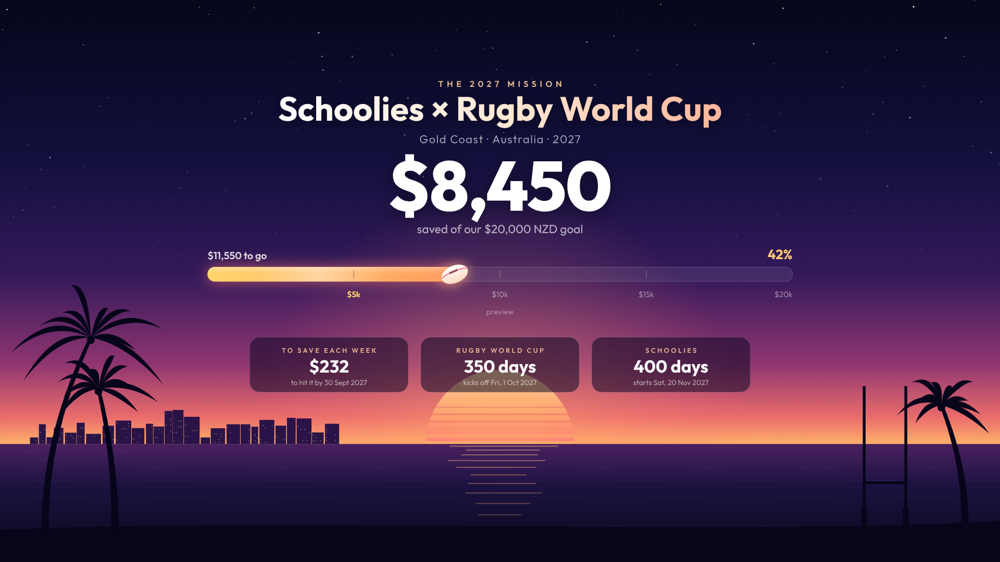

# Mission 2027: Schoolies × Rugby World Cup savings tracker

A live wallpaper that tracks our savings toward a **$20,000** trip to Australia in 2027, for Schoolies on the Gold Coast and the Rugby World Cup.



The wallpaper shows:
- the total saved, a progress bar with a rugby ball that moves along it, and $5k milestones
- how much we need to save each week to reach the goal by the save-by date
- countdowns to the Rugby World Cup kick-off (1 Oct 2027) and Schoolies
- **live updates**: it checks for a new total every 2 minutes, and again as soon as a laptop wakes up or reconnects. When the number goes up, the bar slides forward and a "+$X" appears.

---

## 1. Put it online (one-time, about 2 minutes)

1. Merge this branch into `main`.
2. On GitHub, go to **Settings → Pages**. Under *Build and deployment*, choose **Deploy from a branch**, then pick `main` and `/ (root)`. Click **Save**.
3. After about a minute, the site is live at
   `https://kahuiqueenstown-ship-it.github.io/Kahui-Progress-Bar-/`

> GitHub Pages is free only for **public** repos, which means anyone with the link could see the savings total. If you'd rather keep the repo private, you'll need a paid GitHub plan.

## 2. Make it your laptop background

For a background that updates itself, use one of these free apps:

| Laptop | App | What to do |
|---|---|---|
| **Windows** | [Lively Wallpaper](https://apps.microsoft.com/detail/9ntm2qc6qws7) (Microsoft Store) | Click **+** and paste the site URL with `?wallpaper` on the end |
| **Mac** | [Plash](https://apps.apple.com/app/plash/id1494023538) (App Store) | Click **Add Website** and paste the same URL |

The URL to paste:

```
https://kahuiqueenstown-ship-it.github.io/Kahui-Progress-Bar-/?wallpaper
```

URL options (add them with `&`, for example `?wallpaper&static`):
- `?wallpaper` hides the settings button so the background stays clean
- `&static` turns off the animation (twinkling stars, shimmer) to save battery. The numbers still update live.

**Just want a picture instead?** Open the site, press **E** (or move the mouse and click the ⚙ button in the bottom right), choose your screen size, and click **Download wallpaper PNG**. Then set it as your background the normal way. A picture won't update itself, so download a new one whenever you want to refresh it.

## 3. Update the savings

There are three ways. Pick whichever suits you.

### A) By hand on GitHub (updates everyone's laptop)
Open [`data/progress.json`](data/progress.json) on GitHub, click the ✏️ pencil, and change the number:

```json
{
  "saved": 4250,
  "updated": "2026-11-01T00:00:00Z",
  "source": "manual"
}
```

Click **Commit changes**. Every laptop picks up the new number within about 10 minutes. You can do this from your phone too.

### B) By hand on one laptop only
Press **E** on the wallpaper page, switch to **This laptop**, then type the total or use **+ Add** for each deposit. Only that laptop sees these numbers. Click **Reset laptop** to go back to the shared number.

### C) Automatically from Xero
If the trip money sits in its own bank account in Xero (for example, one called "Trip Savings"), a GitHub Action can read that account's balance every 30 minutes and update the bar on its own.

1. **Create a Xero Custom Connection.** Go to [developer.xero.com](https://developer.xero.com/app/manage) → **New app** → **Custom connection**. Give it permission to read reports (`accounting.reports.read`) and settings (`accounting.settings.read`), and authorise it for your organisation. Custom connections have a small monthly fee from Xero and are available in NZ, AU, UK and US.
2. Copy the app's **Client ID** and **Client Secret**.
3. In this GitHub repo, go to **Settings → Secrets and variables → Actions**:
   - **Secrets** tab: add `XERO_CLIENT_ID` and `XERO_CLIENT_SECRET`
   - **Variables** tab: add `XERO_ACCOUNT_NAME`, set to the bank account's exact name in Xero (for example `Trip Savings`)
   - Optional variable: `XERO_BASELINE`. If the account already had money in it before you started saving, put that amount here and it will be subtracted.
4. Go to **Actions → Sync savings from Xero → Run workflow** to test it. After that it runs every 30 minutes, and whenever the balance changes it updates `data/progress.json` and every wallpaper follows.

To check the account names Xero can see, run this on your own computer:

```bash
XERO_CLIENT_ID=... XERO_CLIENT_SECRET=... node scripts/xero-sync.mjs --list
```

> If Xero is set up, it overwrites `data/progress.json` whenever the balance changes. Use **either** Xero **or** manual updates on GitHub (option A), not both.

## Changing the goal, dates or wording

Edit [`data/goal.json`](data/goal.json):

```json
{
  "goal": 20000,
  "currency": "NZD",
  "saveBy": "2027-09-30",
  "events": [
    { "label": "Rugby World Cup", "note": "kicks off", "date": "2027-10-01" },
    { "label": "Schoolies", "note": "starts", "date": "2027-11-20" }
  ]
}
```

- `saveBy` is the date the weekly-savings figure is worked out from.
- The Schoolies date is a placeholder. Set it once you've booked your week.

## Files

| File | What it is |
|---|---|
| `index.html`, `app.js` | The wallpaper page (no build step) |
| `data/goal.json` | Goal, currency, dates, wording |
| `data/progress.json` | Current savings total (edited by hand or by Xero) |
| `scripts/xero-sync.mjs` | Reads the Xero bank balance and writes `progress.json` |
| `.github/workflows/xero-sync.yml` | Runs the Xero sync every 30 minutes |
